<p align="center">
  <a href="https://ko-fi.com/todd0042">
    
  </a>
</p>

---

# 🛠️ VibeBuilder IDE

[](https://github.com/Todd0042/VibeBuilder-IDE-public/releases)
[](LICENSE)
[-orange.svg)](https://github.com/Todd0042/VibeBuilder-IDE-public/releases)
[-green.svg)](https://github.com/Todd0042/VibeBuilder-IDE-public/releases)
[]()
[]()
[]()
[](https://ko-fi.com/todd0042)

> **Code on your desktop's horsepower from any laptop or Android device: a fast, no-frills IDE whose files, terminals and AI agents (Claude Code, agy) live in a locked-down container at home, with an agent-change timeline that shows exactly what the AI touched, and app testing that streams each window of the app you're building straight to your laptop.**

<p align="center">
  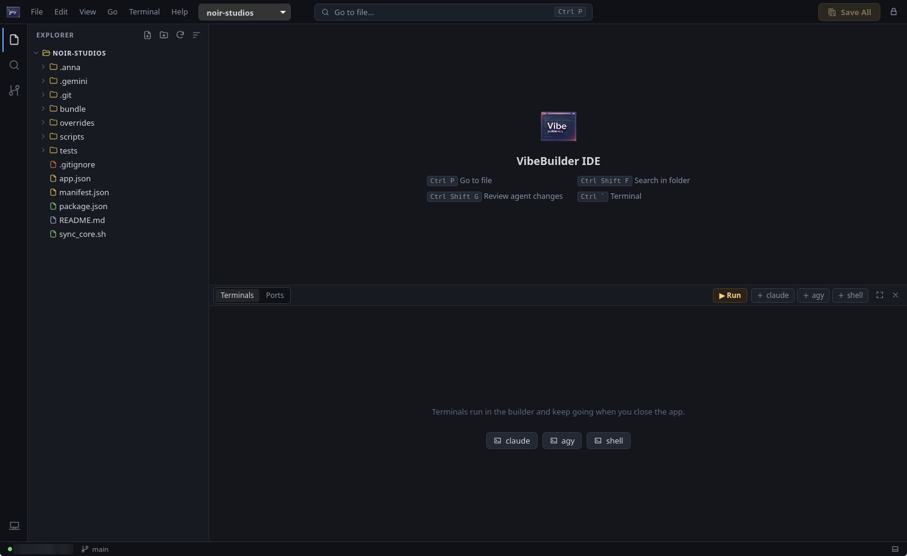
</p>

---

## 📖 Table of Contents

* **Part 1 — Overview & Quick Start**
  * [🧠 What Is VibeBuilder IDE?](#-what-is-vibebuilder-ide)
  * [🔁 How It Works in 3 Steps](#-how-it-works-in-3-steps)
  * [📸 Visual Tour](#-visual-tour)
  * [✨ Highlights at a Glance](#-highlights-at-a-glance)
  * [🚀 Quick Download & Installation](#-quick-download--installation)
* **Part 2 — Technical Documentation & Architecture Reference**
  * [1. System Architecture ([server/](server/), [builder/](builder/), [desktop/](desktop/), [mobile/](mobile/))](#1-system-architecture)
  * [2. Authentication & Security Model ([server/src/vbide/auth/](server/src/vbide/auth/), [server/src/vbide/jail.py](server/src/vbide/jail.py))](#2-authentication--security-model)
  * [3. Agent-Change Timeline & History Store ([server/src/vbide/history/](server/src/vbide/history/))](#3-agent-change-timeline--history-store)
  * [4. Terminals & AI Agents ([builder/agent/](builder/agent/))](#4-terminals--ai-agents)
  * [5. App Testing: Window Streaming, Ports & Phone ([desktop/src-tauri/src/tunnel.rs](desktop/src-tauri/src/tunnel.rs), [server/src/vbide/tunnels.py](server/src/vbide/tunnels.py))](#5-app-testing-window-streaming-ports--phone)
  * [6. The Builder Image ([builder/Containerfile](builder/Containerfile))](#6-the-builder-image)
  * [7. Configuration (`vibebuilder.env`) & Commands ([vibebuilder.env.example](vibebuilder.env.example), [bin/vibebuilder](bin/vibebuilder))](#7-configuration-vibebuilderenv--commands)
  * [8. Repository Structure & End-to-End Test Suite ([server/tests/](server/tests/), [desktop/e2e/](desktop/e2e/))](#8-repository-structure--end-to-end-test-suite)
  * [9. Privacy, Agent Trust & Licensing ([LICENSE](LICENSE))](#9-privacy-agent-trust--licensing)

---

# Part 1 — Overview & Quick Start

## 🧠 What Is VibeBuilder IDE?

**VibeBuilder IDE** is a self-hosted remote IDE for people who code with AI agents. Your desktop (the one with the big CPU, the GPU and all your toolchains) does the work; your laptop or Android phone/tablet just needs the client app.

It splits into three pieces:
1. **🖥️ The Server (`vb-server`)**: A hardened container that holds the sign-in, your files' change history and the only door to the internet. It never runs anything from your workspace.
2. **🧰 The Builder (`vb-builder`)**: An Arch Linux container with every common language and toolchain preinstalled. Claude Code, agy and your shells run here as `coder` with passwordless `sudo`, so agents can `pacman -S` whatever they need without touching your real system.
3. **💻 The Client Apps (Laptop & Android)**:
   * **Linux Laptop**: A fast, distraction-free desktop workbench: folder tree, tabs, editor, find and folder search, diffs, and terminals at the bottom.
   * **Android Phone & Tablet**: A full mobile client tailored for touch: mobile drawer explorer, symbol/touch bar for CodeMirror, xterm.js terminal with shell & agent quick keys, camera QR pairing, background tunnel service, and on-the-go review of agent change sets.

---

## 🔁 How It Works in 3 Steps

1. **Set Up the Desktop**: Copy `vibebuilder.env.example` to `vibebuilder.env`, then `vibebuilder install`, `build` and `start`. Put Tailscale Serve, Cloudflare Tunnel, or another HTTPS reverse proxy in front of it (see the [Remote Access Setup Guide](remote-access.md)).
2. **Pair Your Laptop or Phone**: Open the app, enter your server's address (or point your phone's camera at the pairing QR code from `vibebuilder pair`), and confirm the 30-second one-time code. Then sign in with your authenticator app's 6-digit code.
3. **Code & Review**: Open a project, start a Claude or agy terminal, and watch the **Changes** timeline fill up with exactly what the agent changed, file by file, ready to review, restore or undo.

---

## 📸 Visual Tour

### 🗂️ Workbench: Explorer, Editor & Terminals
<p align="center">
  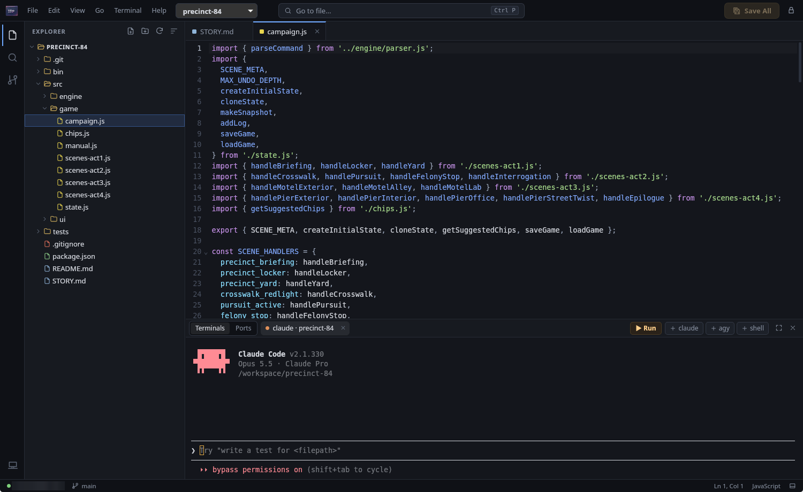
</p>

### ▶️ App Testing: Run App
<p align="center">
  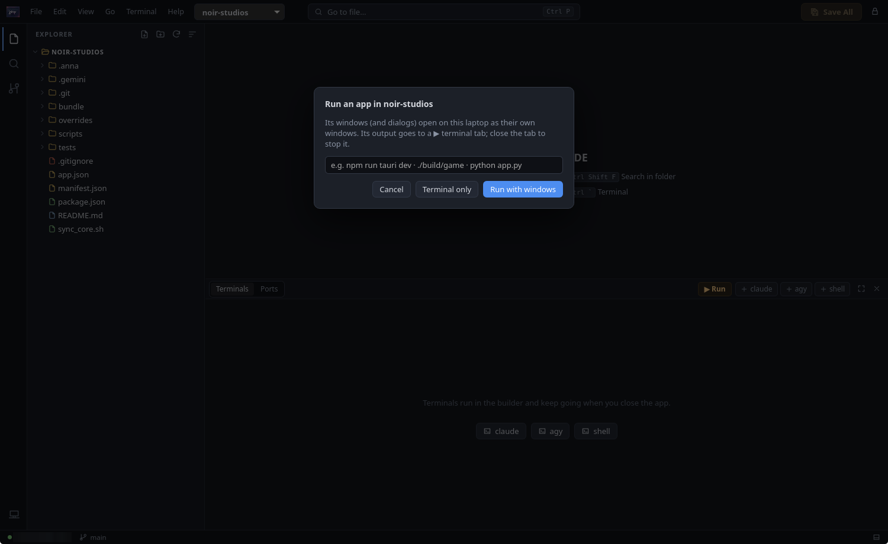
</p>

### 🔐 Pairing & Sign-In
<p align="center">
  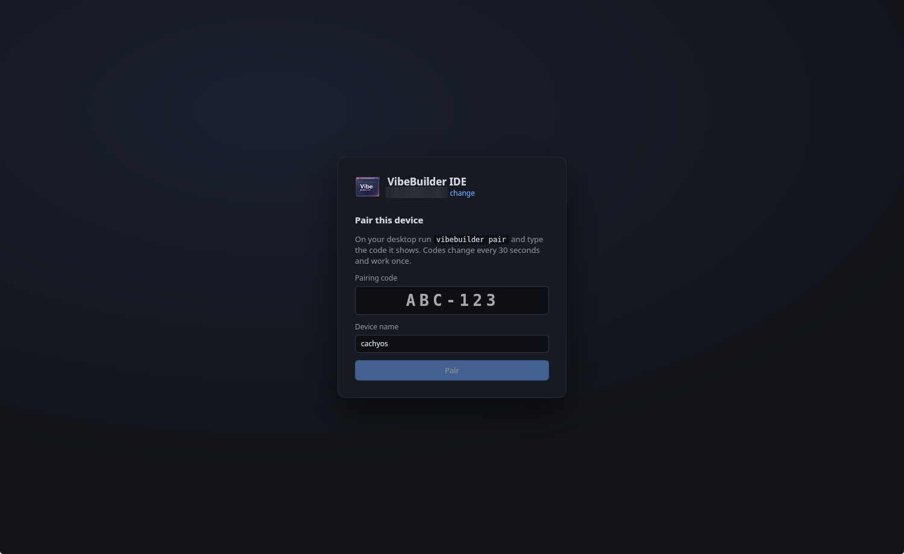
  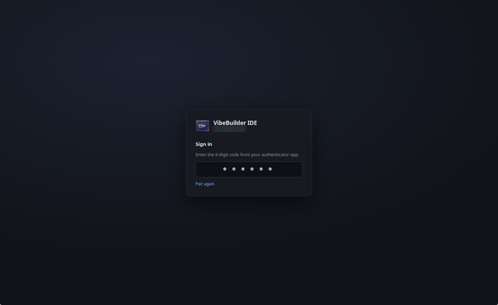
</p>

### 📱 Devices & Shortcuts
<p align="center">
  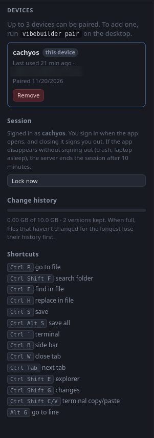
</p>

### 📱 Android Client
<p align="center">
  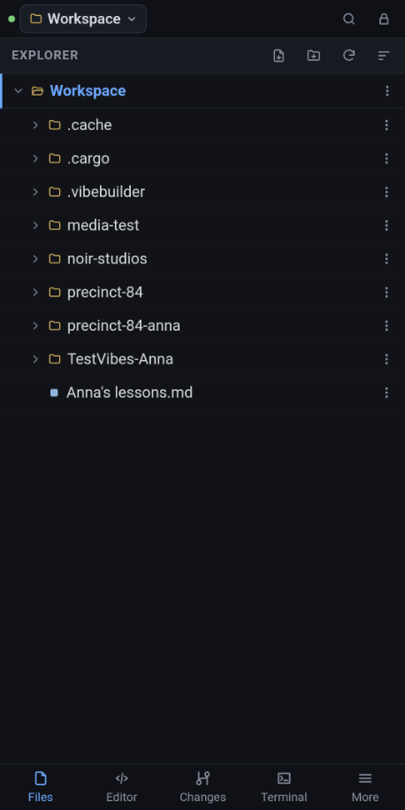
  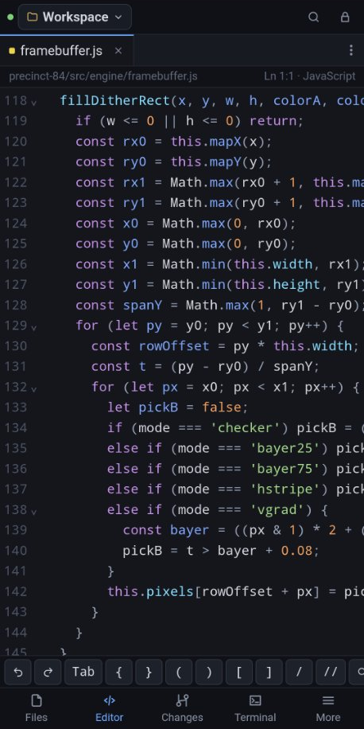
  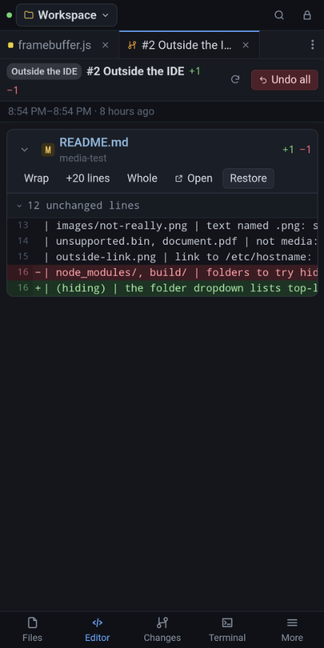
</p>
<p align="center">
  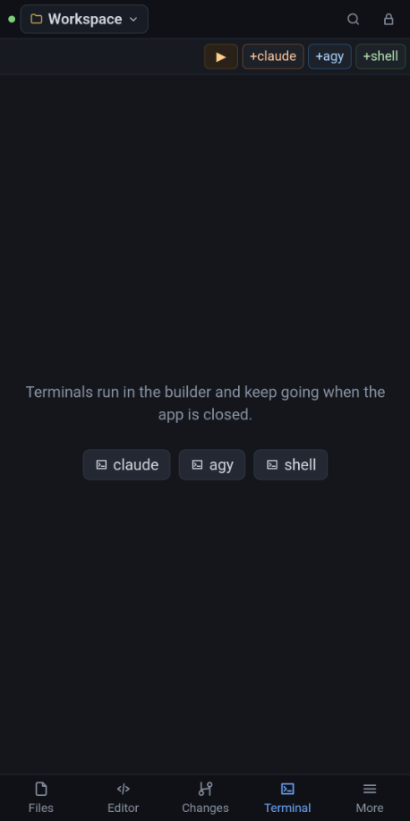
  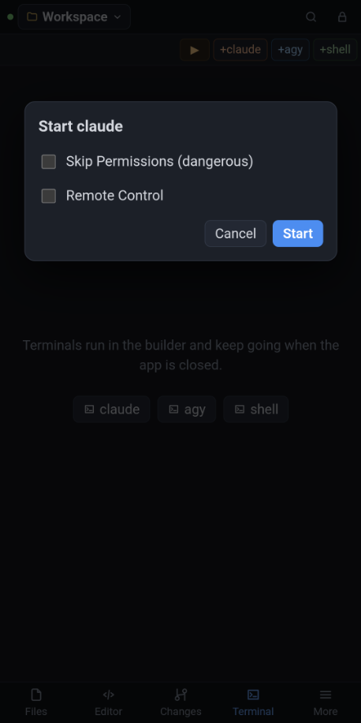
  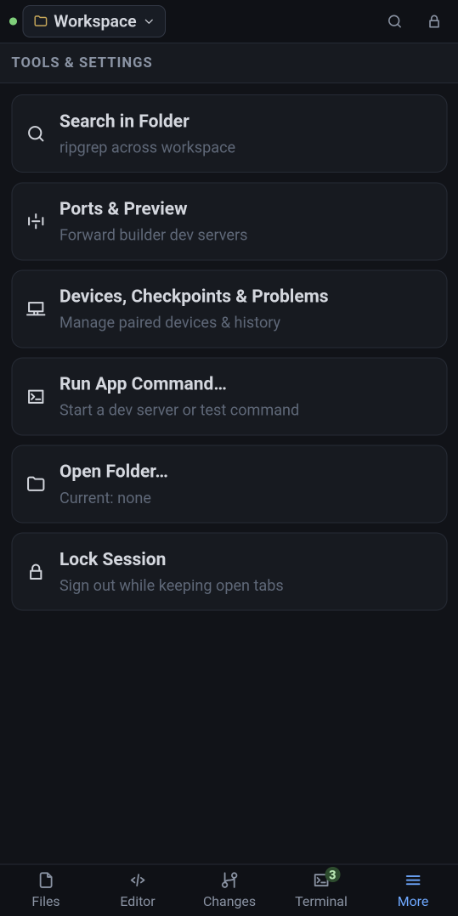
</p>
<p align="center">
  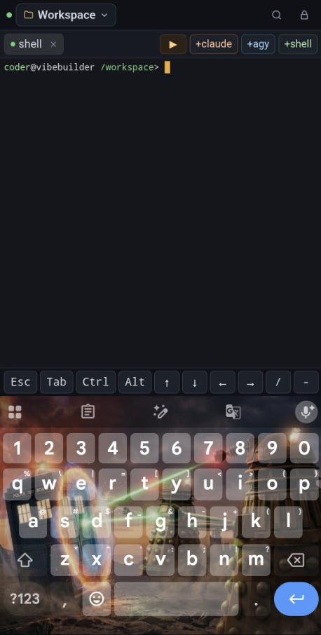
  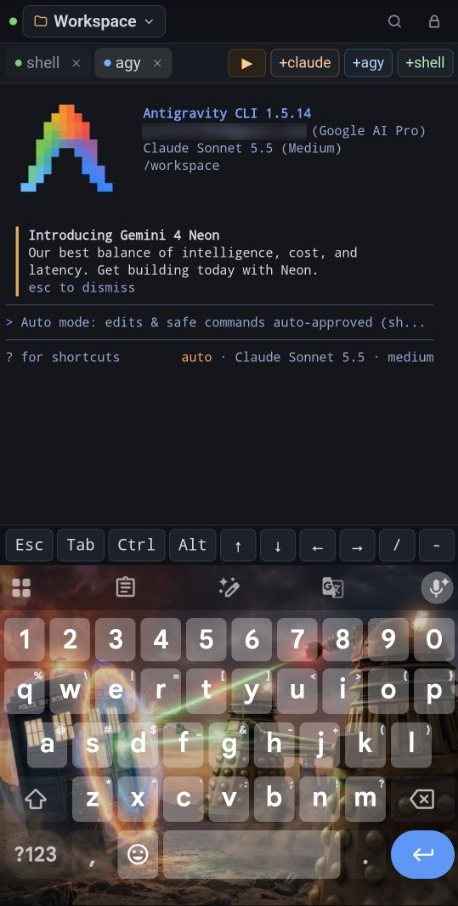
  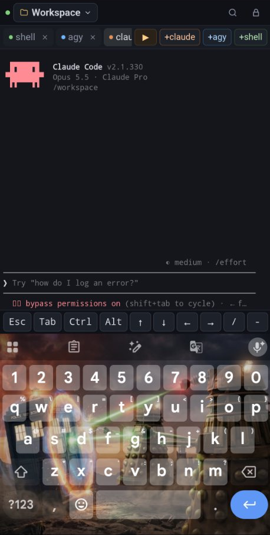
</p>

---

## ✨ Highlights at a Glance

* **🔍 Agent-Change Timeline**: Every burst of agent edits becomes a change set, shown file by file with only the changed lines and 3 lines of context, expandable to more context or the whole file. Restore one file or undo the whole set. Filter by "last 15 minutes", "last hour" or "today", or open any file's own history. Claude's edits are labelled exactly through an edit hook.
* **🧷 Automatic Checkpoint Commits**: Forgetting to commit is the classic vibecoding mistake. A few minutes after changes settle, the work in progress is committed to a side branch, `checkpoints/<branch>`, with a message Claude Haiku writes from the diff. Your branch, staged changes and files are never touched, nothing is pushed, and `.env` files, keys and dependency folders are left out. It starts over on top of each real commit. On by default, switchable per project.
* **📜 Starter Agent Rules**: A project without agent rules gets an `AGENTS.md` the first time you open it (read by agy directly, and by Claude Code through a one-line `CLAUDE.md`). It covers security first, a 500-line file limit, committing after every session, no silent errors (every failure shown in full to whoever runs the code, secrets masked, and only a plain message plus reference ID for site visitors), proving changes work with realistic end-to-end tests before releases, and not guessing or wrecking things. Edit it, or delete it: it never comes back.
* **💾 Auto-Save That Stays Out of the Way**: Each changed file saves itself 3 minutes after its last change (a new change restarts the timer), plus a big orange **Save All** button (`Ctrl+Alt+S`). If an agent edits a file you have unsaved changes in, you choose: Keep mine, Take theirs or Compare.
* **🖥️ Terminals That Keep Running**: Claude, agy and shell terminals live in the builder and keep working while the app is closed. Reopening replays the scrollback.
* **📱 Native Android Client**: Supervise agents and code from your phone or tablet on the go. Built with Tauri 2 + Svelte 5 sharing state with the desktop workbench. Features an on-screen CodeMirror symbol bar (`{`, `}`, `=>`, `;`, `Tab`), quick touch keys above the soft keyboard in xterm.js (`Esc`, `Ctrl+C`, `|`, `~`, arrow keys), a camera QR pairing scanner, agent launch flags dialog (Skip Permissions, Remote Control), interactive in-app Screen Preview to verify GUI apps (Qt, GTK, SDL, Tkinter, etc.) with touch clicks and keyboard input directly on mobile, and a persistent Android foreground service (`TunnelForegroundService`) so port forwarding and connections stay alive in the background.
* **▶️ Per-App Window Streaming**: **Run App** (`F5`) starts your app in the builder, and its windows, dialogs and popups open on your laptop as normal windows you can move and resize (Wayland apps: Qt, GTK/Tauri, SDL, raylib, GLFW). No full-desktop streaming.
* **🌐 Port Forwarding & Phone Testing**: Forward any dev server in the builder to `localhost` on the laptop with one click, or enable automatic dev port forwarding for instant prototyping. A phone plugged into the laptop shows up in the builder's `adb devices`, so `./gradlew installDebug` just works.
* **🔐 Sign-In Before Anything**: Nothing but the sign-in screen answers until you're signed in: no file, no terminal, no health page. A paired device (at most 3; tokens stored in your desktop keychain or Android encrypted storage) plus the current authenticator code, asked when the app opens.
* **🕰️ Rolling 10 GB History**: Every version of every changed file is kept, compressed. When it hits the cap, the files unchanged the longest lose their history first.
* **📦 Rebuilds Never Lose Your Tools**: Anything installed with pacman inside the builder is recorded and reinstalled automatically when the image is rebuilt.
* **📁 Multi-Project & GitHub Folder Discovery**: The workspace treats root directories as projects, and automatically treats a `GitHub/` folder as an alternate workspace root so cloned repositories appear seamlessly alongside workspace projects in dropdowns, explorers, and checkpoint commits.
* **💾 Binary Assets & File Downloads**: Dedicated inspection view for binary assets displaying file metadata, size, timestamps, direct one-click downloads, and optional lossy text view.
* **⌨️ Familiar Keys & Touch Shortcuts**: `Ctrl+P` go to file, `Ctrl+F` / `Ctrl+H` find and replace, `Ctrl+Shift+F` folder search (ripgrep), `Ctrl+G` go to line, `` Ctrl+` `` terminal panel, `Ctrl+Alt+O` open folder, plus touch-optimized action sheets and symbol bars on mobile.

---

## 🚀 Quick Download & Installation

### 🖥️ Desktop Server (Linux, Rootless Podman)
You need Linux with **Podman** (rootless) and **systemd**. An NVIDIA GPU is optional (the builder gets it automatically when the NVIDIA Container Toolkit's CDI spec exists).
```bash
# 1. Clone the repository
git clone https://github.com/Todd0042/VibeBuilder-IDE-public.git
cd VibeBuilder-IDE-public

# 2. Your settings (at least VB_PUBLIC_URL)
cp vibebuilder.env.example vibebuilder.env
$EDITOR vibebuilder.env

# 3. Install, build (the first builder build downloads a lot: allow 20-40 min) and start
bin/vibebuilder install
bin/vibebuilder build
bin/vibebuilder start

# 4. Create your authenticator secret and scan the QR (it clears after 30 s)
bin/vibebuilder new-totp
bin/vibebuilder auth-qr
```
Then make `VB_PUBLIC_URL` reach `127.0.0.1:8765` over HTTPS — no domain is required if you use Tailscale Serve (`https://*.ts.net`). See the **[Remote Access Setup Guide](remote-access.md)** for step-by-step instructions covering Tailscale Serve/Funnel, [Cloudflare Tunnel](deploy/cloudflared.example.yml), DuckDNS + [Caddy](deploy/Caddyfile.example)/Nginx, and SSH port forwarding.

### 🐧 Laptop App: Linux AppImage
Download the latest `VibeBuilder-IDE_<version>_amd64.AppImage` and `SHA256SUMS` from [GitHub Releases](https://github.com/Todd0042/VibeBuilder-IDE-public/releases):
```bash
sha256sum -c SHA256SUMS   # optional: check the download
chmod +x VibeBuilder-IDE_*_amd64.AppImage
./VibeBuilder-IDE_*_amd64.AppImage
```
It runs on Ubuntu 22.04 or newer and other distros from 2022 on (Debian 12+, Fedora, Mint, Pop!_OS, Arch...). Enter your server's address, then on the desktop run `bin/vibebuilder pair` and type the code. The app keeps its device token in your keychain (KWallet or GNOME Keyring). For app testing, also install `waypipe` and `android-tools`.

### 📱 Android App: APK
Download the latest `VibeBuilder-IDE_<version>_android.apk` (or architecture-specific APK) and `SHA256SUMS` from [GitHub Releases](https://github.com/Todd0042/VibeBuilder-IDE-public/releases):
```bash
sha256sum -c SHA256SUMS   # optional: check the download
```
Install the APK on your Android device (Android 8.0+, ARM64 or x86_64). Enter your server's address (or tap the camera button on the pairing screen to scan the `vibebuilder pair` QR code right off your desktop monitor), confirm the 6-character code, and sign in with your authenticator app's 6-digit TOTP code. The device token is stored in Android encrypted storage.

### 🛠️ Run the Laptop App from Source
```bash
git clone https://github.com/Todd0042/VibeBuilder-IDE-public.git
cd VibeBuilder-IDE-public
bin/vb-app            # checks for rust, nodejs/npm, webkit2gtk-4.1 and libsoup3; first run compiles (a few minutes)
bin/vb-app build      # or build your own AppImage (needs only Podman)
```
`bin/vb-app build` builds inside an Ubuntu 22.04 container ([deploy/appimage/Containerfile](deploy/appimage/Containerfile)), so the AppImage works on older distros too, not just on the one you built it on.
`bin/vb-app` also installs a "VibeBuilder IDE" launcher and icon, since Wayland takes a window's icon from its `.desktop` entry. If the clone has a `vibebuilder.env`, its `VB_PUBLIC_URL` becomes the app's default server.

### 📱 Build & Run the Android App from Source
```bash
git clone https://github.com/Todd0042/VibeBuilder-IDE-public.git
cd VibeBuilder-IDE-public
bin/vb-android --check   # verify Android SDK/NDK, Java 17, Rust targets, and Node
bin/vb-android dev       # run live on a connected phone or emulator in dev mode
bin/vb-android build     # build release APKs and AABs
```
`bin/vb-android` automatically detects `ANDROID_HOME`, `NDK_HOME`, `JAVA_HOME`, and configures the build using your `VB_PUBLIC_URL`.

---
---

# Part 2 — Technical Documentation & Architecture Reference

> *The sections below are an engineering reference for VibeBuilder IDE: how the pieces fit, what protects what, and every setting.*

---

## 1. System Architecture

The client apps (laptop and Android) talk HTTPS and WebSockets to the server, and only the server talks to the builder, over a private Podman network.

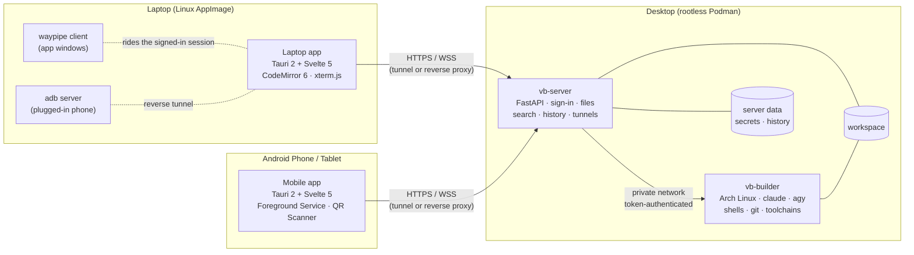

* **vb-server** ([server/src/vbide/](server/src/vbide/)) holds everything that must stay out of the agents' reach: the authenticator secret, device tokens, sessions and the change history. It runs with a read-only root, every capability dropped and no new privileges, with the workspace mounted `nodev,nosuid,noexec`. It never runs git or anything from the workspace; git commands go to the builder.
* **vb-builder** ([builder/](builder/)) is the agents' box: a persistent container (your `sudo pacman` installs survive restarts) with `--userns=keep-id`, so `coder` inside is you on the host and "root" inside is an unprivileged host user. Its small agent ([builder/agent/vbagent/](builder/agent/vbagent/)) owns the terminals, runs git and opens tunnel endpoints, and it only accepts the server.
* **desktop** ([desktop/](desktop/)): the Linux desktop app built with Tauri 2 and Svelte 5, featuring native window streaming with waypipe, adb reverse tunnels, and keychain integration.
* **mobile** ([mobile/](mobile/)): the native Android app built with Tauri 2 and Svelte 5. Uses a custom Kotlin plugin (`VbAndroidPlugin`) for encrypted token storage and camera QR code pairing, and `TunnelForegroundService` to keep tunnels and sessions persistent in the background.
* **client-core** ([client-core/src/](client-core/src/)): shared TypeScript library: API client, WebSocket communication, diffing, fuzzy matching, auto-save timers, and path resolution.
* **client-state** ([client-state/src/](client-state/src/)): shared reactive Svelte 5 state stores powering the file tree, active editors, terminals, checkpoints, change-set reviews, and problem diagnostics across both desktop and mobile apps.
* **tunnel-core** ([tunnel-core/src/](tunnel-core/src/)): shared Rust crate providing WebSocket TCP port tunneling and multiplexing across both desktop and Android clients.

### Live Updates (`/api/v1/live`)
One WebSocket per app carries file changes, git status, change sets and terminal events, so the tree, open editors and the timeline update the moment an agent writes a file.

---

## 2. Authentication & Security Model

| | |
|---|---|
| Before sign-in | only `/api/v1/auth/pair` and `/api/v1/auth/login` answer; no docs, no health page |
| Authenticator | TOTP: only the code for the current 30-second step, and each code works once (no replay) |
| Pairing | `vibebuilder pair`: a QR (scannable with mobile camera) plus a 6-character code, valid 30 s, single use, stored only as a hash |
| Devices | at most 3; device token lives in the OS keychain (desktop) or encrypted storage (Android); removing a device ends its session within seconds |
| Sessions | in memory only (a server restart signs everyone out); the app checks in every 2 minutes, and the server ends a session it hasn't heard from in 10 minutes |
| Failures | 5 per client address → 15-minute lockout; 30 across all addresses → pairing and login pause |
| Setup QR | shown in the terminal for 30 s, never written to disk |
| WebSockets | authenticate with their first message, so tokens never appear in URLs or logs; the Origin is checked |

### The Workspace Jail ([server/src/vbide/jail.py](server/src/vbide/jail.py))
Every file operation opens paths relative to the workspace with `openat2(RESOLVE_BENEATH | RESOLVE_NO_SYMLINKS | RESOLVE_NO_MAGICLINKS | RESOLVE_NO_XDEV)`. The kernel itself refuses `..`, symlinks (including ones an agent plants), `/proc` magic links and mount crossings. The end-to-end tests try all of these.

### Client Addresses Behind a Tunnel or Reverse Proxy
Set `VB_PROXY` in `vibebuilder.env` to match how traffic reaches `127.0.0.1:8765`: `none` (default: socket peer, safe for Tailscale Serve / SSH tunnels), `forwarded` (reads the proxy-appended rightmost `X-Forwarded-For` entry for Caddy, Nginx, or Tailscale Funnel), or `cloudflare` (reads `CF-Connecting-IP` for Cloudflare Tunnel; legacy `VB_TRUST_CF=1` also enables this). See [remote-access.md](remote-access.md) for details.

---

## 3. Agent-Change Timeline & History Store

* **Recording** ([history/recorder.py](server/src/vbide/history/recorder.py)): inotify watches the workspace. Each changed file is stored once it has settled (2 s), and edits that arrive close together (5 s of quiet ends a set) become one **change set**.
* **Attribution**: Claude Code reports each edit through a PostToolUse hook ([builder/agent/vb-edit-hook](builder/agent/vb-edit-hook)), so its changes are labelled exactly. Other changes are credited to whichever terminal was busy at the time.
* **Storage** ([history/store.py](server/src/vbide/history/store.py)): SQLite for the index, zstd-compressed blobs for file versions (Python 3.14's `compression.zstd`). Files over 4 MB are skipped.
* **The 10 GB cap**: when history passes `history_cap_bytes`, the files that have gone longest without a change lose their history first, so what you're actively working on keeps its full past.
* **Review** ([desktop/src/components/ReviewView.svelte](desktop/src/components/ReviewView.svelte)): hunks with 3 lines of context, "More context" and "Whole file", restore a file, or undo a whole set.

### Checkpoint Commits ([server/src/vbide/checkpoints.py](server/src/vbide/checkpoints.py), [builder/agent/vbagent/checkpoints.py](builder/agent/vbagent/checkpoints.py))
* **When**: every recorded change (an agent's change set, or a save from the editor) marks its project. Once the project has been quiet for `VB_CHECKPOINT_DELAY_SEC` (180 s), the builder makes a checkpoint of each git repo that changed. **Checkpoint now** in the status bar doesn't wait.
* **What**: the working tree as `git add -A` would take it (`.gitignore` applies), built in a temporary index, so the branch, the staging area and the files stay exactly as they are. Left out, with a notice in the app: files that look like secrets (`.env`, keys, `credentials*.json`...), files containing something that looks like a token or private key, dependency and build folders, and new files over 5 MB.
* **Where**: `checkpoints/<branch>`. While the branch doesn't move, each checkpoint follows the last; after a real commit the next one starts on top of it. Merges, rebases and detached HEADs are left alone. Nothing is ever pushed. To get a file back: `git checkout checkpoints/main -- path`.
* **Messages**: `claude -p --model haiku` with no tools, run outside the repo, writes a title and a short changelog from the diff (secrets already removed). If it fails, a plain summary of the changed files is used.
* **Safety**: git runs in the builder with hooks and fsmonitor disabled, so nothing in a repo's config gets to run. The switch and the last result per project are kept in `data/checkpoints.json`.

### Starter Agent Rules ([server/src/vbide/agent_rules.py](server/src/vbide/agent_rules.py))
The first time a project is opened, if it has none of `AGENTS.md`, `CLAUDE.md`, `GEMINI.md`, `.cursorrules` and the like, it gets [templates/AGENTS.md](server/src/vbide/templates/AGENTS.md) plus a `CLAUDE.md` that imports it. Each project gets them only once (`data/agent_rules.json`), so a deleted file stays deleted.

---

## 4. Terminals & AI Agents

* **Kinds**: `claude`, `agy`, `shell` (fish) and `run` (Run App). Terminals are real PTYs in the builder that keep running with no app attached; reattaching replays their scrollback.
* **Claude Code** is installed into the builder's home on first start, along with the edit hook. **agy** is used if it exists at `~/.local/bin/agy` on the desktop (mounted read-only). Agents run with `--dangerously-skip-permissions`: the container is the boundary, not a permission prompt.
* **Agent Launch Options**: Launch dialogs allow customizing startup flags (such as Skip Permissions or Remote Control flags) before starting an agent.
* **Mobile Touch Controls**: On Android, terminals feature an on-screen quick keys bar above the soft keyboard (`Esc`, `Ctrl+C`, `Tab`, `|`, `~`, `/`, `-`, `_`, arrow keys) for effortless terminal control on phones.
* **Signing agents in**: sign in once in a builder shell. For agy, the builder has no keyring, so it keeps its token in a file in the builder's home.
* **New shells** greet you with a short, witty fastfetch ([builder/rootfs/etc/vibebuilder/](builder/rootfs/etc/vibebuilder/)).

---

## 5. App Testing: Window Streaming, Ports & Phone

All three ride the signed-in session (`/api/v1/tunnel`, `/api/v1/reverse`, `/api/v1/preview`) and stop when you lock or close the app. The client only connects to targets it registered itself.

* **Run App (`F5` / Desktop)**: runs a command in the builder under `waypipe server`; the laptop runs the `waypipe` client, so each window, dialog and popup arrives as its own native window, scaled and resizable. Output goes to a ▶ terminal tab, and closing the tab stops the app. Supports both native Wayland apps and X11/Tkinter apps (bridged via xwayland-satellite). No audio yet.
* **Run App (Mobile Screen Preview)**: on Android, selecting **Run with preview** launches the app in a headless virtual display (`Xvfb`) and streams the display live into an interactive **Screen Preview** tab in the terminal area. You can verify that the app opened, inspect UI layout, tap elements (translated via `xdotool`), and type into input fields, with a seamless toggle to **Console** for viewing runtime logs.
* **Ports**: lists what's listening in the builder and forwards a port to `localhost` on the laptop (it picks another local port if that one is taken).
* **Phone**: the builder's `adb` uses the laptop's adb server through a reverse tunnel, so a phone plugged into the laptop is visible to Gradle and `adb` in the builder.

The desktop needs `waypipe` (windows) and `android-tools` (phone). The builder image includes `Xvfb`, `xdotool`, and image capture utilities for mobile screen preview.

---

## 6. The Builder Image

Arch Linux (`base-devel`) with fish, and:

* **Python** (uv, ruff, pyright), **Node** (npm, pnpm, yarn, bun, deno), **Rust** (stable, plus Windows-gnu, wasm and Android targets), **Go**
* **C/C++**: GCC, Clang, CMake, Ninja, Meson, mingw-w64 (Windows builds)
* **JVM & Android**: JDK 21 and 17, Kotlin, Gradle, Android SDK (platforms 34–36, NDK 27.2 and 28.2)
* **GUI & games**: Qt 6/QML, GTK/WebKit (Tauri), SDL, raylib, GLFW, Vulkan
* **Media & testing**: ffmpeg, ImageMagick, Chromium and Xvfb (browser tests), waypipe
* **More**: Lua, Zig, Nix (single-user), gdb, lldb, valgrind, perf, git, gh, ripgrep, fd, fzf, jq

**Rebuilds.** A pacman hook writes every package you install to `/workspace/.vibebuilder/packages.txt`. `vibebuilder rebuild` builds a fresh image that reinstalls them, and the entrypoint reinstalls anything missing on start. Rebuilding ends running terminals (`claude -c` resumes a conversation).

**GPU.** `vibebuilder gpu-sync` turns NVIDIA's CDI spec into plain device and read-only file mounts ([bin/vb-gpu-sync](bin/vb-gpu-sync)), because Podman's CDI mounts don't work together with `keep-id`. Run it after a driver update.

---

## 7. Configuration (`vibebuilder.env`) & Commands

### `vibebuilder.env` ([vibebuilder.env.example](vibebuilder.env.example))

| Key | Default | What it does |
|---|---|---|
| `VB_PUBLIC_URL` | *(required)* | Where your devices reach the IDE; shown in the pairing QR and used as the laptop app's default server |
| `VB_WORKSPACE_DIR` | `~/vibebuilder-workspace` | The folder the IDE shows; agents can change anything in it |
| `VB_STATE_DIR` | `~/.local/share/vibebuilder` | Secrets, history, the builder's home, Nix store, pacman cache (must not overlap the workspace) |
| `VB_CONTAINER_STORAGE` | *(Podman's default)* | Put Podman's images on a bigger disk (written to `~/.config/containers/storage.conf` if it doesn't exist) |
| `VB_SERVER_PORT` | `8765` | The `127.0.0.1` port your tunnel or proxy forwards to |
| `VB_PROXY` | `none` | How client IPs arrive for lockouts: `none`, `forwarded` (Caddy/Nginx/Funnel), or `cloudflare` (legacy `VB_TRUST_CF=1` still works) |
| `VB_TOTP_ISSUER` | `VibeBuilder` | The name your authenticator app shows |
| `VB_BUILDER_MEMORY` / `VB_BUILDER_CPUS` | `16g` / all cores | Builder limits |
| `VB_APP_IDENTIFIER` | *(tauri.conf.json's)* | Laptop & Android apps: your own app id (keychain entry on desktop, keystore on Android, and saved settings belong to it) |

Changes take effect on `vibebuilder restart` (builder limits: on `vibebuilder rebuild`). No secrets go in this file: the authenticator secret, link token and device tokens are created by the commands below and stay in `VB_STATE_DIR`.

### Commands ([bin/vibebuilder](bin/vibebuilder), [bin/vb-android](bin/vb-android))

```text
vibebuilder install          one-time setup: folders, link token, systemd units
vibebuilder build [what]     build images: builder | server | all
vibebuilder rebuild          fresh builder image (keeps your pacman installs), then restart it
vibebuilder start|stop|restart|status
vibebuilder logs [server|builder]
vibebuilder pair             pair a laptop or phone (QR + 30-second code)
vibebuilder devices          list paired devices;  vibebuilder revoke <id>
vibebuilder new-totp         make a new authenticator secret
vibebuilder auth-qr          show the authenticator QR for 30 s
vibebuilder history          change-history disk use
vibebuilder shell [root]     a shell in the builder (as coder, or root)
vibebuilder gpu-sync         after an NVIDIA driver update: refresh the builder's GPU files

bin/vb-android --check       verify Android SDK/NDK, Java, Rust targets, and Node
bin/vb-android init          initialize mobile Android project
bin/vb-android dev           run on a connected phone / emulator in dev mode
bin/vb-android build         build release APKs and AABs
```

---

## 8. Repository Structure & End-to-End Test Suite

```text
VibeBuilder-IDE/
├── server/                      # vb-server (FastAPI, Python 3.14)
│   ├── src/vbide/
│   │   ├── auth/                # TOTP, devices & pairing, sessions, lockouts, routes
│   │   ├── history/             # inotify recorder, SQLite + zstd store, diffs, routes
│   │   ├── jail.py              # openat2 workspace jail
│   │   ├── files.py             # read, write, rename, delete through the jail
│   │   ├── search.py            # ripgrep folder search
│   │   ├── agent_link.py        # the only client of the builder agent (terminals, git)
│   │   ├── checkpoints.py       # automatic checkpoint commits (when, per-project switch)
│   │   ├── agent_rules.py       # starter AGENTS.md for projects without rules (templates/)
│   │   ├── tunnels.py           # port, reverse and window tunnels for app testing
│   │   ├── live.py              # the live-update WebSocket hub
│   │   └── cli.py               # vbide pair / devices / revoke / auth-qr / new-totp
│   ├── tests/                   # end-to-end: a real server + builder agent on a throwaway workspace
│   └── Containerfile
├── builder/                     # vb-builder image
│   ├── Containerfile            # Arch + toolchains + Android SDK + Nix
│   ├── rootfs/                  # entrypoint, pacman hook, fish greeting, fastfetch
│   └── agent/                   # vbagent: PTY terminals, git, checkpoint commits, tunnels; vb-edit-hook
├── client-core/                 # shared TypeScript: API client, sockets, diff, fuzzy, auto-save
├── client-state/                # shared reactive Svelte 5 state: editors, terminals, tree, changes
├── tunnel-core/                 # shared Rust crate: WebSocket TCP port tunnels & multiplexing
├── desktop/                     # laptop app (Tauri 2 + Svelte 5)
│   ├── src/                     # components, commands & menus, editor, terminals, testing
│   ├── src-tauri/               # Rust: keychain, tunnels, waypipe, adb
│   └── e2e/                     # the real UI in Chromium against a real server
├── mobile/                      # Android client (Tauri 2 + Svelte 5)
│   ├── src/                     # mobile workbench, action sheets, symbol bar, terminal touch keys
│   └── src-tauri/               # Rust + Kotlin: VbAndroidPlugin, foreground tunnel service, QR scanner
├── deploy/                      # Podman quadlet template, systemd unit, cloudflared & Caddy examples
├── remote-access.md             # Remote HTTPS setup: Tailscale Serve/Funnel, Cloudflare, Caddy/Nginx, SSH
├── bin/                         # vibebuilder, vb-app, vb-android, vb-builder-create, vb-gpu-sync
└── vibebuilder.env.example      # every machine-specific setting
```

### Running the End-to-End Test Suite
```bash
cd server && uv venv .venv && uv pip install -p .venv -e '.[test]' -e ../builder/agent playwright
.venv/bin/playwright install chromium
.venv/bin/pytest -q                  # server + builder agent: auth, jail escapes, history, restore, search, terminals, tunnels, checkpoints, agent rules
.venv/bin/pytest -q ../desktop/e2e   # the real UI in Chromium: first run, pairing, sign-in, editing, review, menus, checkpoints
```
The same suite runs on every push ([.github/workflows/ci.yml](.github/workflows/ci.yml)).

---

## 9. Privacy, Agent Trust & Licensing

### 🔒 1. Your Code Stays Home
* VibeBuilder IDE has **no analytics, no telemetry and no accounts**. Your files, history and terminals stay on your desktop; the only outside connection is the tunnel or proxy you set up. (The AI agents you run talk to their own providers, as they would anywhere.)

### 🤖 2. Know What You're Giving the Agents
* Agents run with full rights **inside the builder**: passwordless `sudo`, and no permission prompts. The container keeps them off your real system, but they can change or delete anything in your workspace. The change history and the checkpoint commits let you undo what they did. Keep secrets out of the workspace.

### ⚖️ 3. Software License & Commercial Inquiries
* **Non-Commercial Use**: VibeBuilder IDE is licensed for personal, hobbyist, educational and other non-commercial use under the **[PolyForm Noncommercial License 1.0.0](LICENSE)**.
* **Commercial Licensing Inquiries**: Commercial use (inside a company, as a paid service, or bundled into a product) is not permitted under this license. To ask about a separate commercial license, reach out to **[todd.0042.git@gmail.com](mailto:todd.0042.git@gmail.com)**.
* **Third-Party Open-Source Attributions**: Tauri (MIT/Apache-2.0), Svelte (MIT), CodeMirror (MIT), xterm.js (MIT), FastAPI (MIT), Uvicorn (BSD-3-Clause), pyotp (MIT), segno (BSD-3-Clause), waypipe (MIT), ripgrep (MIT/Unlicense) and the packages in each `package.json` and `pyproject.toml` keep their own licenses. Claude Code and agy are their vendors' products, installed under their own terms.

---

<p align="center">
  If VibeBuilder IDE makes your coding setup better, consider supporting development:<br/><br/>
  <a href="https://ko-fi.com/todd0042" target="_blank">
    
  </a>
</p>

---

<p align="center">
  <a href="https://ko-fi.com/todd0042">
    
  </a>
</p>
